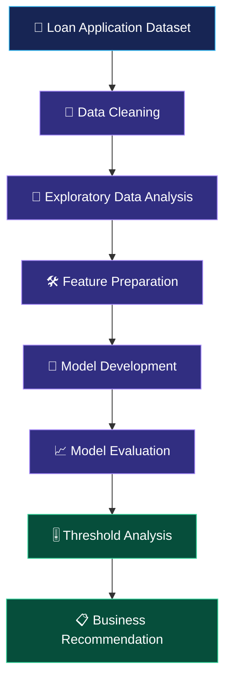

<div align="center">

# 💳 CREDIT PRE-SCREENING ENGINE

### Loan Intake Optimisation | MUC02 · KLU

<p>
  <strong>An analytics-driven approach to smarter loan application screening.</strong>
</p>


<br/>

**[📂 View Repository](https://github.com/ChetanKalagarla/Batch2_2026-10-15_MUCO2-Credit-Pre-Screening-Engine-Loan-Intake-Optimisation)**

</div>

---

## 🌌 01 | Project Overview

The **Credit Pre-Screening Engine** is a data analytics project designed to study historical loan application decisions and explore how a screening threshold can help optimise loan intake.

The project analyses applicant information, credit scores, income, repayment burden, and historical approval outcomes to identify patterns that can support a more efficient review process.

> 🎯 **Core Objective:** Explore how data-driven screening can reduce manual review workload while retaining appropriate human review for applicants who require additional assessment.

---

## 🧭 02 | Business Problem

Loan processing teams need to assess many applications while balancing processing time, risk, and fair treatment of applicants.

| Business Challenge | Analytical Approach |
|---|---|
| Large application volumes | Analyse application and decision patterns |
| Different applicant risk profiles | Examine credit scores and financial indicators |
| Missing credit histories | Identify and retain new-to-credit applicants |
| Manual review workload | Evaluate alternative screening thresholds |
| Risk of incorrect rejection | Examine historically approved applicants among auto-declines |

### 💡 Key Question

**How can historical application data help optimise loan screening without treating a model prediction as a final lending decision?**

---

## 📊 03 | Dataset at a Glance

<div align="center">

| Dataset Metric | Value |
|:---|---:|
| Total Applications | **12,000** |
| Dataset Columns | **19** |
| Missing Credit Scores | **1,039** |
| Missing Monthly Income Before Treatment | **441** |

</div>

The dataset contains loan application information used for data cleaning, exploratory analysis, model evaluation, and threshold-based screening analysis.

*Note: The dataset's historical decisions are used as the reference outcome. They do not establish whether a borrower ultimately repaid a loan.*

---

## ⚙️ 04 | Project Workflow



### 🔬 Analytical Stages

1. **Data preparation** — inspect missing values, correct income units, and preserve applicants without credit scores.
2. **Exploratory analysis** — examine approval patterns across credit scores, employment categories, and repayment burden.
3. **Feature preparation** — prepare the applicant information for modelling.
4. **Model evaluation** — evaluate classification performance using test data and relevant metrics.
5. **Threshold analysis** — assess how a stricter screening threshold changes the number of auto-declines and the review workload.
6. **Business recommendation** — interpret the results alongside operational limitations and the need for human review.

---

## 🔍 05 | Key Analytical Findings

### 01 — Credit Score Patterns

- Applicants with credit scores below 600 had a historical approval rate of **2.0%**.
- Applicants with scores of 800 or higher had a historical approval rate of **85.2%**.
- Applicants without a credit score had a historical approval rate of **53.9%**.

**Insight:** Applicants without credit histories form a distinct group and should not automatically be treated as high-risk solely because their scores are missing.

### 02 — Financial Affordability

- Median FOIR: **31.7%**
- Median loan-to-income ratio: **0.52**
- Historical approval rates varied substantially across FOIR ranges.

**Insight:** Repayment burden and income-related indicators provide useful context for understanding historical lending decisions.

### 03 — Model Performance

At the 0.50 classification threshold, the saved test results showed:

| Evaluation Metric | Result |
|---|---:|
| Accuracy | 79.1% |
| Declined-class Precision | 79.1% |
| Declined-class Recall | 75.5% |
| ROC-AUC | 0.867 |

These metrics describe performance against historical decisions, not actual loan defaults.

---

## 🚀 06 | Recommended Screening Scenario

The project evaluated a stricter threshold of **0.90** for screening analysis.

<div align="center">

| Operational Indicator | Estimated Result |
|:---|---:|
| Monthly applications assumed | 3,000 |
| Applications auto-declined | 456 |
| Analyst hours saved | 190.1 |
| Historically approved applicants among auto-declines | Approximately 21 |

</div>

### 💎 Business Interpretation

The evaluated scenario suggests a potential reduction in manual review workload. However, approximately 21 applicants per month who were historically approved could be auto-declined under the scenario.

**Recommendation:** Treat the 0.90 threshold as an analytical scenario for further review, not an automatically approved production policy. Validate the threshold, investigate potential fairness issues, and provide human review and appeal mechanisms before any operational deployment.

---

## 🧰 07 | Technology Stack

<div align="center">


</div>

- **Python:** Data processing and analysis
- **Pandas and NumPy:** Data cleaning and numerical operations
- **Scikit-learn:** Machine learning and model evaluation
- **Jupyter Notebook:** Code, analysis, visualisations, and documentation
- **Git and GitHub:** Version control and project hosting

*The notebook is the source of truth for the packages and methods actually used in this project.*

---

## 📁 08 | Repository Structure

```text
MUC02-Credit-PreScreening/
│
├── ChetanKalagarla_MUC02_KLU_Notebook.ipynb
│   └── Data analysis, modelling and evaluation
│
├── ChetanKalagarla_MUC02_KLU_Summary.docx
│   └── One-page business insight summary
│
├── MUC02_Credit_PreScreening_Dataset.csv
│   └── Source dataset
│
└── README.md
    └── Project documentation
```

---

## ▶️ 09 | How to Run the Project

### Prerequisites

- Python installed
- Jupyter Notebook or Visual Studio Code with the Jupyter extension
- The required Python packages used by the notebook

### Steps

**1. Clone the repository**

```bash
git clone https://github.com/ChetanKalagarla/Batch2_2026-10-15_MUCO2-Credit-Pre-Screening-Engine-Loan-Intake-Optimisation.git
```

**2. Open the project folder**

```bash
cd Batch2_2026-10-15_MUCO2-Credit-Pre-Screening-Engine-Loan-Intake-Optimisation
```

**3. Open the notebook**

Open `ChetanKalagarla_MUC02_KLU_Notebook.ipynb` in VS Code or Jupyter Notebook.

**4. Run the analysis**

Select the Python kernel and execute the notebook cells from top to bottom. Keep the CSV in the same folder as the notebook.

---

## ⚖️ 10 | Limitations & Responsible Use

- Historical approval decisions are not equivalent to actual repayment outcomes.
- Model performance may change when applicant populations or lending policies change.
- Missing credit scores require careful handling and should not, by themselves, justify rejection.
- Threshold selection involves trade-offs between workload reduction and incorrect rejection.
- Fairness, explainability, data privacy, and regulatory compliance require further assessment.
- This project is an analytical exercise, not a production-ready lending decision system.

---

## 🎓 11 | Project Deliverables

| Deliverable | Purpose |
|---|---|
| Jupyter Notebook | Reproducible analytical workflow |
| Word Summary | Concise business findings and recommendation |
| CSV Dataset | Input data for analysis |
| GitHub Repository | Version control and project documentation |

---

<div align="center">

## ✨ Built for Data-Driven Decision Support

**MUC02 · Credit Pre-Screening Engine · Loan Intake Optimisation**

<sub>Developed by Chetan Kalagarla | KLU | 2026</sub>

<br/>


</div>
